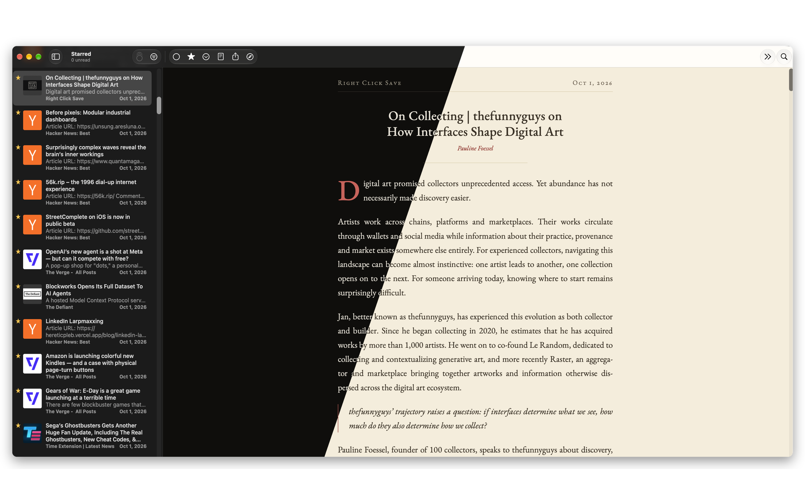

<!-- nnw-theme-identity:start -->
# Prayer Book

A NetNewsWire theme by [Benjamin Meadows](https://thebenmeadows.com/).
<!-- nnw-theme-identity:end -->

The design is taken from [OrthodoxPrayers.net](https://orthodoxprayers.net/), a prayer book for the browser: EB Garamond, a parchment page by day and a vigil page by night, red for every link and label, justified and hyphenated text, and a red capital that drops two lines at the start of each article with the rest of the opening word run in beside it in small capitals.

https://github.com/user-attachments/assets/c46b6fc1-85ac-45f8-885b-8b1ac1e6689f

## Install

On iOS and macOS, open this link on the device:

`netnewswire://theme/add?url=https://github.com/mdws-org/nnw-prayer-book/releases/latest/download/Prayer.Book.nnwtheme.zip`

Or download `Prayer.Book.nnwtheme.zip` from the [latest release](https://github.com/mdws-org/nnw-prayer-book/releases/latest), unzip it, and on the Mac double-click the `.nnwtheme` folder. On iOS, put the unzipped folder in iCloud Drive and choose it under Settings → Article Theme → Add Theme.

Day and Night follow the system appearance.

## Article layout

- The running head has the feed name at the left and the date at the right on one hairline, as a printed book heads its pages.
- The byline is set as a red italic attribution under the title.
- Links are red with no underline at rest, and a heavier underline on hover. This is the register the printed books use for rubrics: red marks what is not the text.
- Paragraphs are justified, and the template's script sets their lines: it chooses the breaks for the whole paragraph, lets a word space close as well as open, and hangs punctuation at the line ends. On a phone's forty-character line the browser's own justification leaves one line in five with a gap over twice the word space; the script leaves about one in thirty. It is the script OrthodoxPrayers.net uses. A paragraph beside a floated picture, one in a right-to-left script and one with a word wider than the line are left to the browser: ragged right on a phone, justified on the Mac.
- With Article JavaScript turned off the page is set by the stylesheet alone: ragged right on a phone, justified by the browser on the Mac, and no drop cap.
- The capital is fitted by its letter, as the printed prayer books fit theirs: the opening word runs in at the height of its own letters (over the leg of an A, the foot of an L), the second line stands off the widest point of the capital below it, and the capital's foot is on the second line's baseline.
- The drop cap goes on the first text paragraph, however deep the feed wraps it, when that paragraph opens like prose: on a word that starts with a capital A to Z in the paragraph's own text, and two lines or longer. A one-line opening, a byline, and an opening inside a link, in bold or italic, or on a quotation mark, a digit or an emoji stay plain text. Quotations, lists, captions, tables, image-only paragraphs, posts with no title (Mastodon, Bluesky), and aggregator feeds whose first lines are "label: link" (Hacker News, Lobsters) are passed over.
- Headings are red small capitals, centered. Quotations are italic with a red hairline at the margin. Code sits on a wash of the paper in the system monospace.
- `lang="en"` on the article wrapper is what turns hyphenation on: NetNewsWire's page does not declare a language, and WebKit does not hyphenate without one. Articles in other languages get English break points.

## Build

`src/` is the source. `build.sh` embeds the two EB Garamond files into `stylesheet.css` as data URIs (NetNewsWire cannot load a font file from inside a bundle), puts the script in `src/justify/` into both templates as one inline script (NetNewsWire's page allows inline script only), and writes the bundle. `./build.sh --install` also copies it into NetNewsWire's Themes folder on this Mac. Edit `src/`, never the bundle. NetNewsWire 7.3 and later read `template7.3.html` in place of `template.html`; it is the same page plus the feed's own media (enclosures, Media RSS, podcast audio): the primary picture under the rule and the rest after the text. Keep the two templates in step.

`src/justify/engine.js` sets the lines and is OrthodoxPrayers.net's `justify-engine.js`. `theme.js` is this theme's part. `drop-caps.js` is written by `tools/fit_drop_caps.mjs`, which holds each capital's two distances and measures the font to turn them into a table for a phone's leading and one for the Mac's. Run it after changing the font, the capital's size or weight, or a leading: `./build.sh && node tools/fit_drop_caps.mjs && ./build.sh` (it needs playwright-core and its WebKit build).

`fixtures/` holds articles from live feeds (The Verge, Ars Technica, Daring Fireball, Platformer in feed and Reader View shape, Hacker News, r/programming, Mastodon, YouTube, Simon Willison, the Rust blog, Time Extension), plus the `podcast` and `media-rss` enclosure fixtures from `nnw-theme fixture add`. `npx nnw-theme@2 check` renders every fixture through NetNewsWire's own template and scripts in WebKit for iPhone, iPad and Mac, light and dark. `fixtures/refresh.py <dir>` fetches fresh ones.

## Licenses

The theme's stylesheet and template are under the Zero-Clause BSD license in `Prayer Book.nnwtheme/LICENSE`. EB Garamond is embedded under the SIL Open Font License, and the hyphenation patterns in the script are from the justif library under the MIT license. Both are reproduced in `Prayer Book.nnwtheme/NOTICE.txt`. The repository's tooling files come from [dave-atx/netnewswire-theme-template](https://github.com/dave-atx/netnewswire-theme-template) under Apache 2.0 (`LICENSE`).
